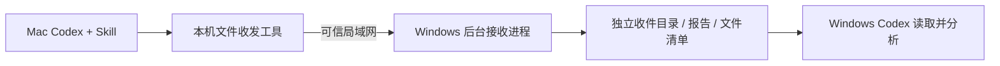

# Agent Bridge

**在 Codex 对话中，把执行报告和项目交付包直接发给另一台电脑。**

一个可安装的开源 skill，最初为 SpaceWatch 的开发流程而做：Windows Codex 协调 Android、后端和下一轮需求，另一个账号的 Mac Codex 复刻 iOS。完成一轮后，在 Mac 对话中发送报告、代码 ZIP 和截图，Windows Codex 收取并阅读，省去“Mac → 手机 → Windows”的中转。

**当前交付：`skills/agent-bridge/`。** 无需桌面程序或 Qt，不使用任何模型 API Key，不读取或共享 Codex 登录材料。公开仓库为 [Xiaoyu9021/agent-bridge](https://github.com/Xiaoyu9021/agent-bridge)，预览版与安装包见 [Releases](https://github.com/Xiaoyu9021/agent-bridge/releases)。

Windows 当前 **68 项测试通过**，并通过无 Qt 独立环境、两个后台进程和系统凭据库的端到端测试。Mac skill 已安装运行；真实 Windows ↔ Mac 局域网双向三附件交付、报告阅读和已读回执已完成，使用合成联调资料。

2026-11-03，用户确认已在实际 SpaceWatch 开发对话中完成一轮真实交付试运行。这是用户确认的使用结果；公开仓库只保留脱敏说明，不上传真实工程、执行包或报告正文。可复现的合成演示见 [演示流程](docs/DEMO.md)。

## 如何使用

将本仓库或 [skills/agent-bridge](https://github.com/Xiaoyu9021/agent-bridge/tree/main/skills/agent-bridge) 的 GitHub 链接交给 Codex，并说：

> 请从 https://github.com/Xiaoyu9021/agent-bridge 的 skills/agent-bridge 安装 Agent Bridge skill，并配置本机作为文件交接端。

当前也可以把 `artifacts/agent-bridge-skill.zip` 交给另一端 Codex：解压后读取 SKILL.md，执行随附的 scripts/install.py、bootstrap.py，再 setup。两端分别安装一次，Agent 自己完成依赖和后台进程配置。

首次配对：Windows Codex 生成连接信息 → 交给 Mac Codex → Windows 核对 Mac 名称并确认。通常不需要用户填写 IP、端口或目录。系统凭据库必须可用，端口需在可信局域网可达；软件不自动修改防火墙。

之后只需自然语言：

> **Mac：**把本轮 SpaceWatch 的执行报告、代码压缩包和截图发给 Windows。

> **Windows：**收取 Mac 最新交付，阅读报告，整理完成情况和遗留问题。

Windows 的 skill 自动将资料保存到独立收件目录，Codex 读取返回的报告路径。反向发下一轮执行单使用相同能力，需要将反向连接也配对一次。每个方向独立授权。

## 交付状态是明确的

| 状态 | 表示什么 |
|---|---|
| delivered_to_receiver | 对方后台进程已完整保存并校验文件 |
| received_verified | 对方已将交付导出到收件目录并复核 |
| read_at 有值 | 对方 Agent 在实际阅读报告后确认已读 |

已读不等于代码验收通过。网络超时不能直接判定成功或失败；使用原交付 ID 查询、重试，不生成重复任务。未完整校验的交付不会进入收件列表。

## 工作原理



Skill 指导 Agent 使用工具；工具运行轻量 HTTP 服务和本地控制服务。后台收件不需要模型一直推理，也不会自动唤醒空闲聊天或自动执行收到的代码。电脑需要开机、联网且接收进程运行。

每个端点有独立身份。任务、设备授权和附件索引存 SQLite，附件分块传输并进行 SHA-256 与落盘复核。访问令牌只保存在系统凭据库，数据库只存哈希；本地控制接口只监听回环地址，并与局域网业务接口分开。每轮保存原始报告、附件、TASK.md 和 manifest.json。

## 开发与验证

Python 3.11+。纯后台依赖：FastAPI、Uvicorn、httpx、Pydantic、platformdirs、keyring。PySide6 仅为保留的桌面原型可选依赖。

```sh
python -m venv .venv
python -m pip install -e '.[dev]'
python -m ruff check .
python scripts/build_skill.py
python scripts/build_skill.py --check
python -m pytest -q
python scripts/check_publish_tree.py
python scripts/verify_skill.py
```

请将上面的 python 指向项目 .venv。verify_skill 需要先执行 `python skills/agent-bridge/scripts/bootstrap.py`，随后使用技能自己的无 Qt 环境、系统凭据库、两个独立接收进程和独立 CLI 调用进行真实 HTTP 测试；仅在本机回环模拟 Windows/Mac。测试使用合成资料，不代表 SpaceWatch App 的实际开发验收。

运行时源码以 `src/codex_bridge/` 为准，`scripts/build_skill.py` 将必要核心同步到 skill/runtime，保证只下载技能文件夹也可安装。不要手改生成的 runtime。构建不打包 .runtime 虚拟环境、用户任务或凭据。

测试证据、平台范围和当前限制见 [测试报告](docs/TEST_REPORT.md) 与 [真实双机回执](docs/evidence/real-lan.0.1.2.json)。新 skill 已完成基本真实双向交接，真实 SpaceWatch 交付由用户确认试运行通过；大文件 LAN 和真实断网恢复待验证。CI 矩阵已配置，但在线结果以实际运行记录为准。

发布包使用明确的文件清单，排除本地运行环境和任务数据，固定 ZIP 元数据便于复现。SHA256SUMS.txt 与 skill-checksums.json 随包生成。CI 在六组测试通过后才生成技能包；发布步骤和已知限制见 [发布说明](docs/RELEASE.md)。

## 目录

| 路径 | 内容 |
|---|---|
| skills/agent-bridge | 可独立安装的技能、说明、脚本及随附运行代码 |
| src/codex_bridge/agent | 后台收件、Agent 命令、本地安全控制和交付记录 |
| src/codex_bridge/{server,client,storage} | 复用的传输、鉴权和持久化核心 |
| tests | 核心、交付、重试、权限、技能安装和历史 GUI 回归 |
| scripts/build_skill.py | 同步并生成可分发的 skill ZIP |
| docs/MAC_SKILL_INSTALL.md | Mac Codex 的安装与联调执行说明 |

此前桌面版本保留为原型，参见 [历史说明](docs/DESKTOP_PROTOTYPE.md)，不再作为主要用户入口。

## 范围与安全

当前先支持 Codex 自然语言调用下的显式文件交接和报告读取。同机不同 Agent 可用不同 profile 隔离。DeepSeek Harness、WorkBuddy、自动任务执行、聊天接管、额度监测和 Git 接力尚未接入。

HTTP 不提供传输加密，仅限可信 LAN 或已有加密的私有网络。端口不映射公网。不要发送 .env、私钥或账号材料。不自动运行或解压附件；应用代码变更需要另行明确目标工程和授权。无断点续传、不开机自启动；文件上限默认 1 GiB、每轮总计 2 GiB。

系统凭据库不可用时明确失败，严禁明文回退。详见 [安全说明](docs/SECURITY.md) 和 [技能命令参考](skills/agent-bridge/references/commands.md)。

自有代码采用 [MIT](LICENSE)。第三方依赖遵守各自许可。贡献请阅读 [贡献指南](CONTRIBUTING.md)。
