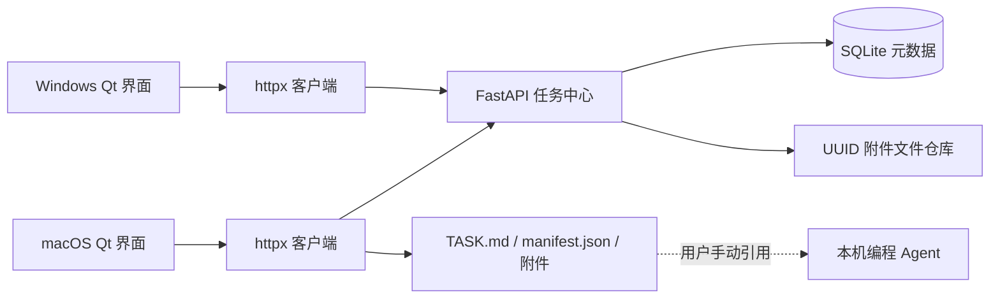

# 架构与技术取舍

Codex Bridge V0.1 是人工任务交接工具。不同账号的编程 Agent 通过用户手动引用导出目录参与，程序不访问 Agent 会话。

## 各层职责

| 模块 | 职责 |
|---|---|
| models | UUID、附件、任务、结果、状态和输入约束 |
| storage | SQLite 事务、设备哈希令牌、任务可见性和附件索引 |
| server | REST、请求鉴权、流式上传、本地配对控制、进程生命周期 |
| client | httpx、流式下载及校验、重试用固定 UUID、本地历史缓存 |
| services | 文件哈希、导出、设备身份和系统凭据库 |
| ui | 中文窗口、4 秒轮询、后台工作队列、失败重试 |

## 任务与结果的提交协议

1. 发送端计算附件大小和 SHA-256，生成任务与附件 UUID。
2. POST 创建包含固定附件清单的草稿。草稿仅创建者可见，未进入接收列表。
3. PUT 将原始文件字节逐块写入 UUID.part；限制大小、检查磁盘、计算哈希并 fsync。
4. 重读落盘文件验证后替换 UUID.bin，数据库才将附件置为 complete。
5. POST publish 在数据库事务中验证全部附件 complete，再发布任务和 pending 事件。
6. 接收端人工接收、开始、完成或失败；结果使用相同的草稿—上传—发布流程。

创建和发布以 UUID 幂等，同 UUID 不同内容返回 409；重试跳过已校验附件。下载使用独立临时文件并验证，失败删除临时内容。导出先在新临时目录完成全部文件，再整体重命名；不覆盖现有项目。文件和 SQLite 不是分布式事务：进程在替换文件后、记录 complete 前崩溃可能留下未引用的完整文件，重试会重新写入；它不会作为完整附件对外发布。

## 并发与持久化

Qt 的网络、文件哈希、下载和导出进入 QThreadPool；轮询单独保持最多一个进行中请求。服务后台线程独立运行。SQLite 使用 WAL、外键、事务和索引。上传按附件加异步锁，避免同一附件并发写入。每个数据目录的系统文件锁阻止两个 Host 同时启动。

设备令牌只存哈希。Host 本机令牌每次启动轮换并只留在内存；Client 使用系统凭据库，无法安全保存时只留在内存。任务和状态事件保存在 Host；Client 缓存最近一次完整列表，断网仍能阅读历史；新任务/下载等操作仍需要连接 Host。

V0.1.1 首次启动仅展示连接角色和一次粘贴邀请；技术设置折叠。邀请是 `http(s)://私有地址:端口/#bridge-pair=一次性码`，从剪贴板显式交给另一台电脑。连接码只留内存，不进入配置文件。GUI 创建者明确选择“创建连接”后，从本机已启用网络接口中选择具体私有 IPv4，保留高级设置手动覆盖；无可用接口时回退本机模式并解释。CLI 默认仍为回环地址。不做远端发现、扫描或防火墙自动修改。

数据库 schema v1 由 PRAGMA user_version 标识；首次创建幂等执行，拒绝高版本数据库。未来 schema 变化需增加显式迁移，当前没有跨版本迁移需求。

## 刻意接受的限制

- 单任务附件总量包含输入和各次结果；草稿占用声明额度，暂无草稿删除和垃圾回收界面。
- 元数据轮询为分页 REST，GUI 暂时读全量历史，适用于小型双端工作流；大规模历史需后续优化。
- 中断后从头传输，不支持断点续传。
- 无中心服务公网部署、自动执行、Git 同步或多 Agent 调度。
